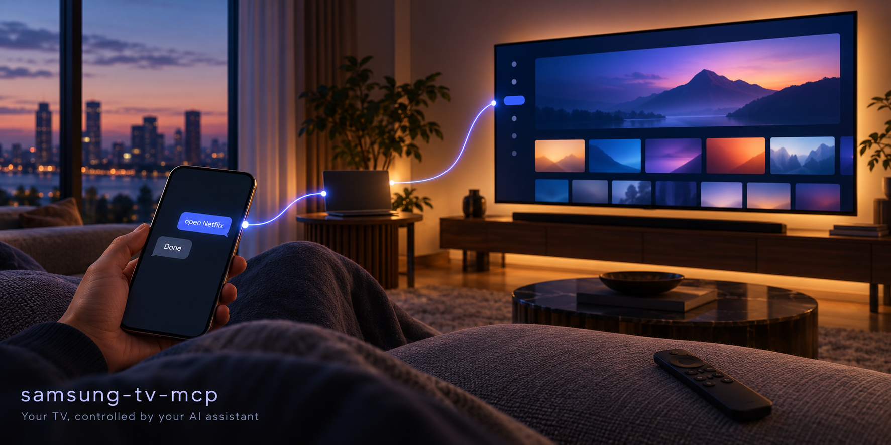

# samsung-tv-mcp



Control a Samsung Tizen TV (2016 or newer) from Claude. Pair once, then say
"mute the TV", "open Netflix", "press up three times" from the desktop or
mobile app and Claude does it.

Built on [samsungtvws](https://github.com/xchwarze/samsung-tv-ws-api). One
Python file, no daemon, no cloud.

## What it gives Claude

| Tool | Does |
|---|---|
| `tv_discover` | Find Samsung TVs on the LAN (SSDP + the TV's own API), or check one IP |
| `tv_pair` | First-time pairing, saves the token |
| `tv_list` / `tv_forget` | Manage paired TVs |
| `tv_status` | Power state, model, reachability |
| `tv_key` / `tv_keys` | Any remote key, once or as a sequence with pauses |
| `tv_launch_app` / `tv_apps` | Launch Netflix, YouTube, Prime etc., or list what's installed |
| `tv_text` | Type into the focused field |
| `tv_power` | Wake-on-LAN on, KEY_POWER off |
| `tv_macro` | Named key sequences (open settings, back out, ...) |

Config: `~/.samsung-tv/config.json`. Several TVs are fine; one is the default.

## Install

Needs Python 3.10+ and a PC on the same Wi-Fi as the TV.

```bash
git clone https://github.com/bibekbyte404/samsung-tv-mcp
cd samsung-tv-mcp
pip install -r requirements.txt
```

Add to `claude_desktop_config.json` (Windows:
`%APPDATA%\Claude\claude_desktop_config.json`, macOS:
`~/Library/Application Support/Claude/claude_desktop_config.json`):

```json
"samsung-tv": {
  "command": "python",
  "args": ["C:/path/to/samsung-tv-mcp/server.py"]
}
```

Restart Claude Desktop. The tools show up as `samsung-tv` in every chat, and on
the mobile app too while the desktop app is running.

Copy `skill/` to `~/.claude/skills/samsung-tv/` so Claude knows how to use it.

## First-time pairing

1. TV on, same Wi-Fi as the PC.
2. On the TV: Settings > General > External Device Manager > Device Connection
   Manager > Access Notification = **First Time Only**.
3. Tell Claude: *"set up my Samsung TV"*. It runs `tv_discover` then `tv_pair`.
4. If the TV shows an "Allow ClaudeRemote?" prompt, press Allow. Many TVs issue
   the token silently.

If discovery finds nothing, give Claude the TV's IP from your router page.

## Known limits

- The TV must be on, or in a standby that keeps Wi-Fi (Power On with Mobile).
- Settings values (DNS, privacy toggles) cannot be written over this API. The
  macros get you to the page; the typing is still done on the TV.
- Works from the mobile app only while the desktop app is open on the PC.
- Menu macros are written for a 2021 Q74A (Tizen 6). Other firmware moves
  items around; check the screen before pressing more keys.
- Does not block YouTube ads. Those are served with the video; TizenTube is
  the on-TV fix.

## Revoking access

Delete the entry from `~/.samsung-tv/config.json` (or use `tv_forget`), and on
the TV remove ClaudeRemote under Device Connection Manager > Device List.

## Licence

MIT
